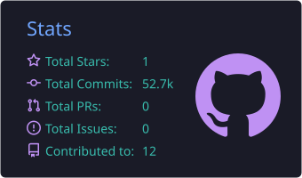

<a href="https://github.com/winpixor">
  
</a>

<div align="center">

<a href="https://github.com/winpixor">
  
</a>

<br/>

<a href="https://github.com/winpixor?tab=followers"></a>
<a href="#"></a>

</div>

---

## `$ whoami`

```yaml
handle:    winpixor
role:      Offensive Security / Bug Bounty Hunter
focus:     [ Web & API, Mobile, Active Directory, Recon ]
languages: [ Python, Go, Bash, C ]
blog:      https://winpixor.github.io
status:    "breaking things responsibly"
```

---

## `$ top -stats github`

<div align="center">




<br/><br/>


</div>

---

## `$ ping socials`

<div align="center">

<a href="https://winpixor.github.io"></a>
<a href="https://www.instagram.com/0x9r4ngu/"></a>
<a href="https://x.com/winpixor"></a>
<a href="https://www.linkedin.com/in/gaurangagautam/"></a>
<a href="https://discordid.netlify.app/?id=937335684681850890"></a>

</div>

---

<div align="center">
<sub>⚖️ Authorized engagements · CTFs · defensive education. <b>Stay legal.</b></sub>
</div>


